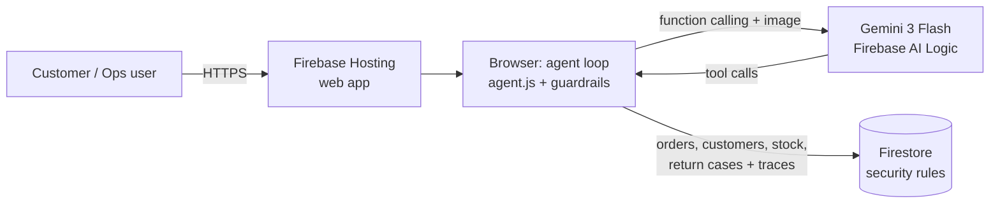
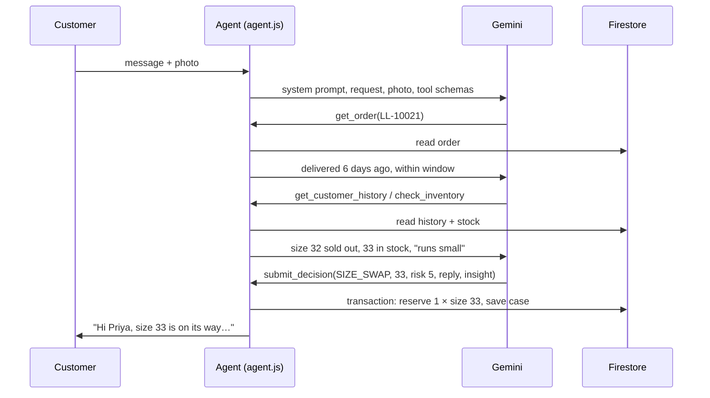

# ReturnWise: an agentic AI returns desk for fashion retail

**Google Cloud AI Builder Cup 2026 · Theme: Retail & Commerce: Intelligent Customer and Business Experiences**

Online fashion return rates often run between 20% and 40%. Every return costs the retailer twice: reverse logistics, and usually the sale itself. Return abuse, such as wearing an item once and sending it back, makes the problem worse. Meanwhile, the reasons customers give ("runs small," "seam split") rarely reach the people who design and merchandise the products.

**ReturnWise** is an AI agent built on **Gemini** that handles a return request from start to finish:

1. **Understands the customer.** Gemini reads their message and **looks at the photo** to spot defects or wear and to check that it actually shows the ordered item.
2. **Gathers the facts itself.** Using function calling, it checks the order, the return window, the customer's return history, **live stock in every size**, and the returns policy, all stored in **Firestore**.
3. **Chooses the outcome that keeps the customer.** It prefers a **size swap or exchange** over a refund whenever the right size is in stock.
4. **Scores fraud risk.** Every request gets a 0–100 score with explainable signals, and risky cases go to a human instead of being rejected automatically.
5. **Writes a warm, clear reply** to the customer, plus an **actionable product insight** (for example, "add 'runs small' to the product page").

**Guardrails in code** sit on top of the model. A high-risk case can never be auto-refunded. An exchange only goes through after the replacement unit is **reserved in a Firestore transaction**, so the agent can never promise stock that doesn't exist.

## Two deployments of the same agent

| | **Live prototype (Firebase)** | **Production design (Cloud Run)** |
|---|---|---|
| Where | `web/`, deployed with `deploy-firebase.sh` | `src/` (Java 17 / Spring Boot), deployed with `deploy.sh` |
| Gemini | Gemini 3 Flash through **Firebase AI Logic** (Gemini Developer API) | Gemini 2.5 Flash on **Vertex AI**, using a service account |
| Data | **Firestore**, accessed with security rules | **Firestore**, accessed with IAM |
| Hosting | **Firebase Hosting** | **Cloud Run** (asia-southeast1) behind Firebase Hosting |
| Guardrails | Run in the agent module, with Firestore rules limiting what clients can write | Run on the server, where clients can't bypass them |
| Billing | Free Spark plan, no billing account needed | Requires a billing account |

Both versions use the same prompt, the same 5 tools plus `submit_decision`, the same guardrails, and the same UI. The live prototype runs on Firebase so that it needs no billing. The Cloud Run version is how we would run ReturnWise in production, because there the guardrails and Gemini credentials stay on the server.

> **Honest note on the prototype:** in the Firebase version the agent runs in the browser. Firestore rules make the catalogue and orders read-only, let clients change stock only by a single unit for a single size, and allow return cases to be created but never edited. A determined user could still bypass the client-side guardrails, which is why the production design moves them to Cloud Run.

## Architecture (live prototype)



### The agent loop



## How we use Google Cloud and Firebase

| Service | Role in ReturnWise |
|---|---|
| **Gemini 3 Flash** (+ 3.1 Flash-Lite fallback) | Multimodal reasoning over the customer's text and photo; agentic **function calling** across 5 tools; a structured final decision through the `submit_decision` function; the customer reply and the merchandising insight. Falls back to Gemini 3.1 Flash-Lite automatically when the free-tier quota is busy or a model is retired. |
| **Firebase AI Logic** | Calls Gemini securely from the web app, so no API key is ever written into our code. |
| **Firestore** | The system of record for products and stock by size, orders, customers, and every return case with its full agent trace. **Transactions** prevent overselling during exchanges, and **security rules** limit what clients can write. |
| **Firebase Hosting** | Serves the customer portal and the operations dashboard. |
| **Cloud Run** *(production design)* | Runs the same agent server-side in Java/Spring Boot with a least-privilege service account. See `src/` and `deploy.sh`. |

## Try it

Open the deployed app and pick a demo order:

| Order | Scenario | What the agent should do |
|---|---|---|
| LL-10021 | Slim jeans too tight (size 32 sold out) | Size swap to an in-stock size and flag that the style runs small |
| LL-10022 | Overcoat seam split, with photo | Assess the defect and approve a refund or exchange |
| LL-10023 | Customer with 7 returns in 90 days returns occasion wear | High risk score, sent to manual review |
| LL-10024 | Sneakers delivered 41 days ago | Outside the window, so policy decides |
| LL-10025 | Linen shirt, "colour not as expected" | Low-risk refund, plus feedback on product imagery |

The **Operations** page shows revenue kept through swaps, the share of cases waiting for review, why customers are returning items, product insights, and the step-by-step trace for each decision.

## Tests

```bash
node --test web/test/agent.test.mjs   # JS agent loop with scripted Gemini responses (6 tests)
mvn test                              # Java agent loop with scripted Gemini responses (4 tests)
```

Both suites cover the size swap with stock reservation, the high-risk override, blocking out-of-stock exchanges, and sending the photo to Gemini as `inlineData`.

## Deploy

**Live prototype (Firebase, no billing):** add Firebase to your Google Cloud project, enable **Firebase AI Logic → Gemini Developer API** in the Firebase console, then in Cloud Shell run:

```bash
./deploy-firebase.sh <your-project-id>
```

**Production design (Cloud Run, needs billing):** run `./deploy.sh <your-project-id>`. See [DEPLOY.md](DEPLOY.md). It uses `firebase.cloudrun.json` and `firestore.cloudrun.rules`.

## Project layout

```
web/                      Live prototype (Firebase)
  agent.js                Agent loop, tools, guardrails, dashboard aggregates
  app.js                  Firebase glue: Firestore store + Gemini via Firebase AI Logic
  index.html, ops.html    Customer portal and Operations dashboard
  seed-data.js, seed.mjs  Demo catalogue and seeding script
  test/                   Agent tests (Node)
src/main/java/...         Production design (Cloud Run, Java 17 / Spring Boot)
firestore.rules           Security rules for the Firebase deployment
```

## What's next

- Move the agent to Cloud Run in production, so guardrails and model access stay on the server.
- Connect to a real order management system and carrier label APIs.
- Add Firebase App Check and Authentication for customers and operations staff.
- Turn the aggregated product insights into automatic size-guide updates.
- Support multiple languages for JAPAC markets, which Gemini already handles natively.
