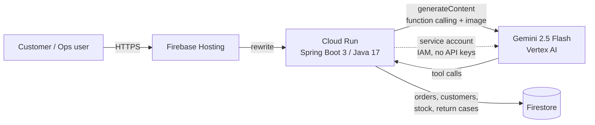
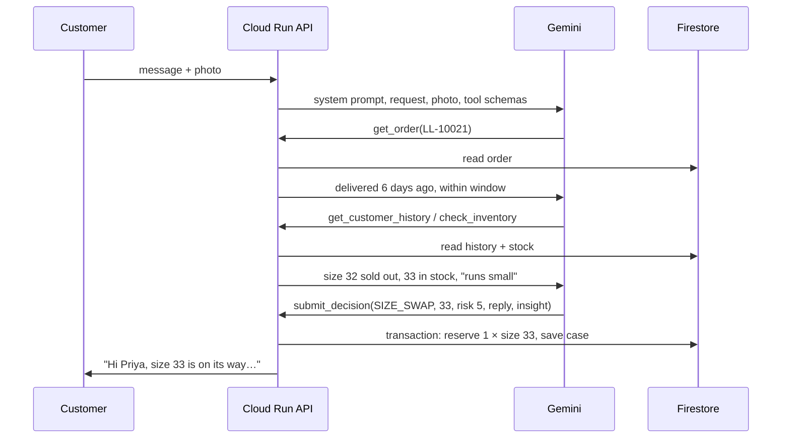

# ReturnWise: an agentic AI returns desk for fashion retail

**Google Cloud AI Builder Cup 2026 · Theme: Retail & Commerce: Intelligent Customer and Business Experiences**

Online fashion return rates often run between 20% and 40%. Every return costs the retailer twice: reverse logistics, and usually the sale itself. Return abuse, such as wearing an item once and sending it back, makes the problem worse. Meanwhile, the reasons customers give ("runs small," "seam split") rarely reach the people who design and merchandise the products.

**ReturnWise** is an AI agent built on **Gemini** that handles a return request from start to finish:

1. **Understands the customer.** Gemini reads their message and **looks at the photo** to spot defects or wear and to check that it actually shows the ordered item.
2. **Gathers the facts itself.** Using function calling, it checks the order, the return window, the customer's return history, **live stock in every size**, and the returns policy, all stored in **Firestore**.
3. **Chooses the outcome that keeps the customer.** It prefers a **size swap or exchange** over a refund whenever the right size is in stock.
4. **Scores fraud risk.** Every request gets a 0–100 score with explainable signals, and risky cases go to a human instead of being rejected automatically.
5. **Writes a warm, clear reply** to the customer, plus an **actionable product insight** (for example, "add 'runs small' to the product page").

Hard **guardrails in code** sit on top of the model. A high-risk case can never be auto-refunded. An exchange only goes through after the replacement unit is **reserved in a Firestore transaction**, so the agent can never promise stock that doesn't exist.

## Architecture



### The agent loop



## How we use Google Cloud

| Service | Role in ReturnWise |
|---|---|
| **Gemini 2.5 Flash (Vertex AI)** | Multimodal reasoning over the customer's text and photo; agentic **function calling** across 5 tools; structured final decision via a `submit_decision` function; customer-facing reply and merchandising insight. |
| **Cloud Run** | Hosts the Spring Boot API and the web app. It runs in `asia-southeast1` (Singapore) under a dedicated service account with only `datastore.user` and `aiplatform.user` roles. |
| **Firestore** | The system of record for products and stock by size, orders, customers, and every return case with its full agent trace. **Transactions** prevent overselling during exchanges. |
| **Firebase Hosting** | The public front door. It rewrites all traffic to Cloud Run, and Firestore security rules deny all direct client access. |

No API keys are stored anywhere. Gemini is called with Application Default Credentials from the Cloud Run service account.

## Try it

Open the deployed app and pick a demo order:

| Order | Scenario | What the agent should do |
|---|---|---|
| LL-10021 | Slim jeans too tight (size 32 sold out) | Size swap to an in-stock size and flag that the style runs small |
| LL-10022 | Overcoat seam split, with photo | Assess the defect and approve a refund or exchange |
| LL-10023 | Customer with 7 returns in 90 days returns occasion wear | High risk score, sent to manual review |
| LL-10024 | Sneakers delivered 41 days ago | Outside the window, so policy decides |
| LL-10025 | Linen shirt, "colour not as expected" | Low-risk refund, plus feedback on product imagery |

The **Operations** page shows revenue kept through swaps, the share of cases waiting for review, why customers are returning items, product insights, and the step-by-step trace for each decision.

## Run locally

```bash
# Offline mode: in-memory data + rule-based stand-in for the agent (no GCP needed)
RETURNWISE_STORE=memory RETURNWISE_AI_MODE=offline mvn spring-boot:run

# Real Gemini + Firestore from your machine
gcloud auth application-default login
GOOGLE_CLOUD_PROJECT=your-project mvn spring-boot:run
```

Tests (`mvn test`) drive the full agent loop against scripted Gemini responses. They cover the size swap with stock reservation, the high-risk override, blocking out-of-stock exchanges, and sending the photo as `inlineData`.

## Deploy

```bash
./deploy.sh <your-gcp-project-id>
```

This enables the APIs, creates Firestore and a least-privilege service account, deploys to Cloud Run, and deploys Firebase Hosting and the Firestore rules. See [DEPLOY.md](DEPLOY.md) for the step-by-step version.

## Project layout

```
src/main/java/com/returnwise/
  agent/    GeminiReturnAgent (agent loop), ToolDeclarations, AgentTools, OfflineRulesAgent
  ai/       GeminiClient (Vertex AI REST + ADC)
  service/  ReturnService (guardrails, stock reservation, persistence)
  store/    Firestore + in-memory repositories, demo seed data
  web/      REST API
src/main/resources/static/   Customer portal (index.html) and Operations dashboard (ops.html)
```

## What's next

- Connect to a real order management system and carrier label APIs.
- Turn the aggregated product insights into automatic size-guide updates.
- Fine-tune risk scoring on historical return outcomes.
- Support multiple languages for JAPAC markets, which Gemini already handles natively.
